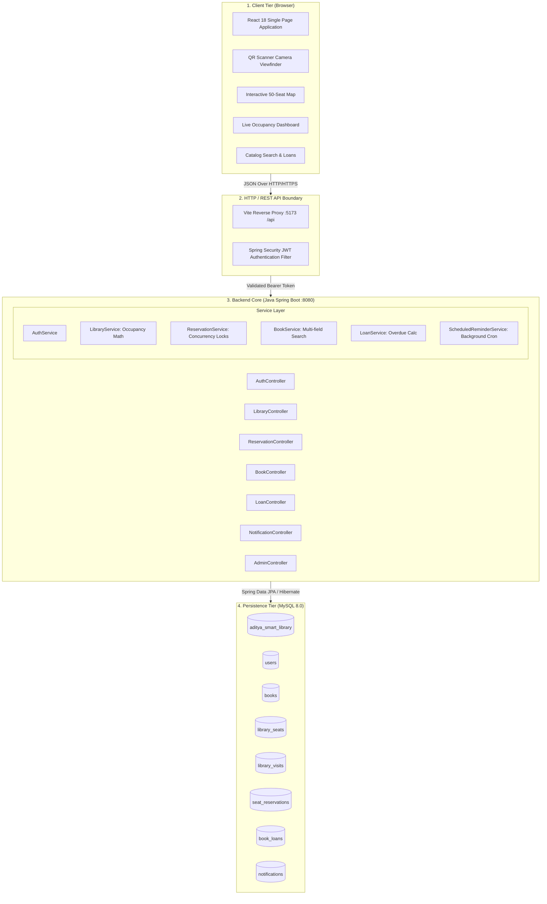
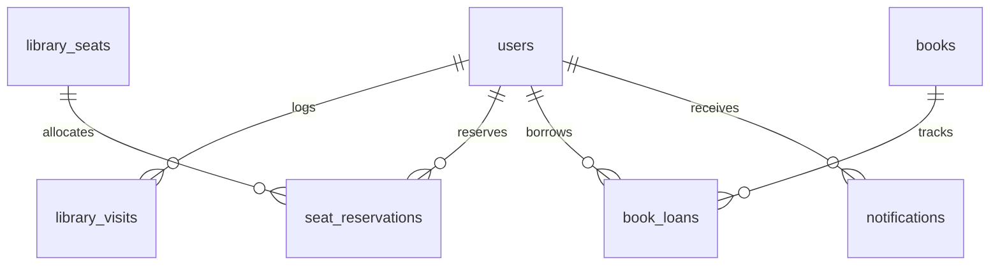

# Smart Library Management System — System Architecture

**Institution**: Aditya University  
**Department**: Computer Science & Engineering / Information Technology  
**Subject**: Application Programming Interface (API)  
**Project**: API-Based Library Occupancy, Seat Availability and Book Due-Date Tracking  

---

## 1. High-Level System Architecture

---

## 2. API Design & Security Architecture

### Authentication & Authorization Flow
1. **Stateless JWT**: When a student or administrator submits credentials to `POST /api/auth/login`, the system verifies the password against a **BCrypt salted hash**.
2. **Token Generation**: Upon successful validation, the server generates an HMAC-SHA256 signed JSON Web Token containing `sub` (roll number), `userId`, and `role`.
3. **Filter Interception**: Subsequent API calls carry the token in the `Authorization: Bearer <token>` header. The `JwtFilter` parses and verifies the signature, injecting the authenticated principal into Spring's `SecurityContext`.
4. **Role Enforcement**:
   - `STUDENT`: Can access their own loans, notifications, seat bookings, and initiate QR scans.
   - `ADMIN`: Exclusively permitted to execute write actions on `/api/admin/**` (adding books, issuing test loans, viewing global logs).

---

## 3. Core Business Logic & Mathematical Calculations

### Live Occupancy & Seat Availability
* **Total Capacity**: 150 students (configurable)
* **Students Inside**: Calculated from registered users currently marked as `is_inside = true` (updated via QR scans).
* **Available Seats**:
  $$\text{Available Seats} = \text{Total Seats (50)} - \text{Occupied Seats}$$
* **Occupancy Percentage**:
  $$\text{Occupancy \%} = \left(\frac{\text{Students Physically Inside}}{\text{Total Library Capacity}}\right) \times 100$$
* **Separation of Concerns**: Students standing, browsing aisles, or consulting reference racks are counted toward hall occupancy without erroneously consuming a seat desk.

### Concurrency Protection on Seat Reservation
* All seat reservations are wrapped in transactional blocks (`@Transactional`).
* If a seat is marked `RESERVED` or `OCCUPIED`, any concurrent reservation attempt by another student immediately throws an exception with HTTP 400 Bad Request, preventing double-bookings.

---

## 4. Database Entity-Relationship (ER) Overview

